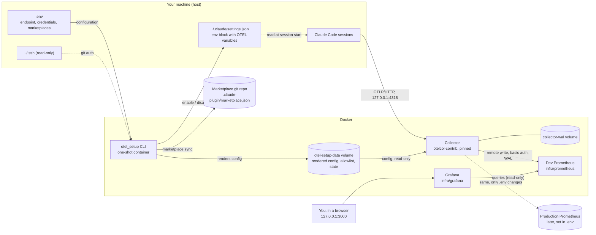
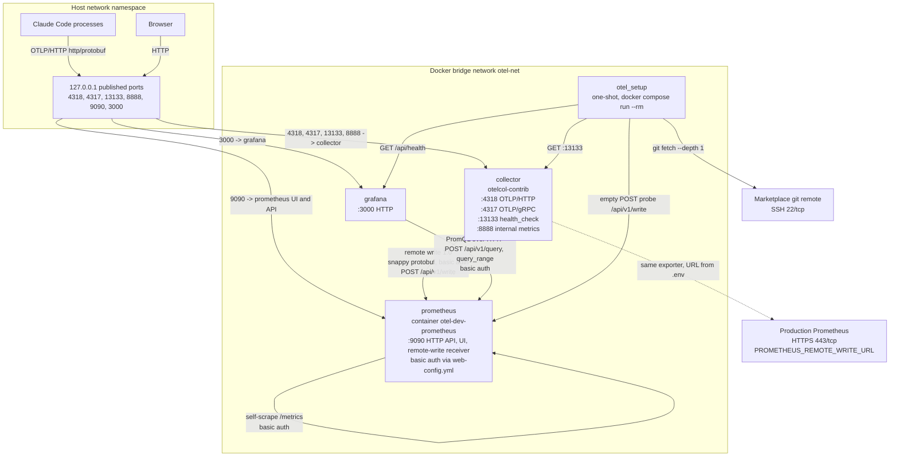
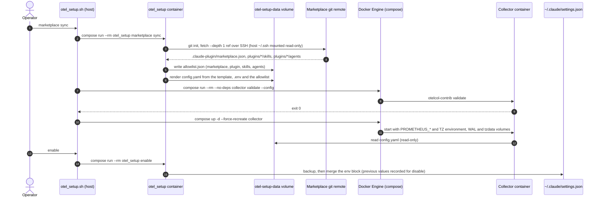
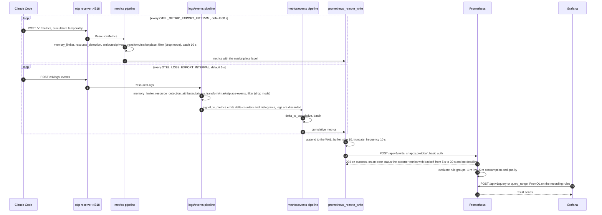
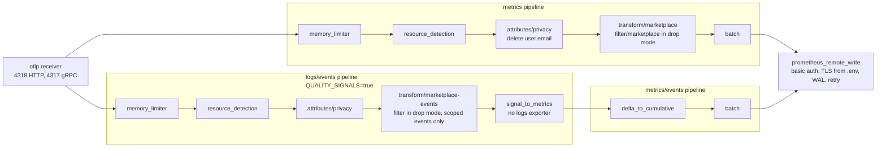

# Claude Code telemetry for private plugin marketplaces

A self-hosted pipeline that collects the OpenTelemetry **metrics** Claude Code emits
about the plugins, skills and agents distributed through your private marketplaces,
and stores them in Prometheus, with Grafana dashboards on top. Everything
stays on infrastructure you control; nothing is sent to third parties.

- Claude Code only. Linux and macOS only (macOS is untested so far).
- Metrics, plus **quality signals** derived from Claude Code events (skill activations, tool
  results, subagent runs, hook runs). The events themselves are read in memory and never
  stored or exported; only counters and histograms reach Prometheus
  (see [Quality signals](#quality-signals)).
- This phase ships a **development** Prometheus and a local Grafana with ready-made dashboards.
  A production Prometheus and alerting are out of scope.

## Contents

1. [Architecture](#architecture)
2. [Quick start](#quick-start)
3. [The `otel_setup` tool (CLI reference)](#the-otel_setup-tool)
4. [Configuration (`.env`)](#configuration-env)
5. [Marketplaces and syncing](#marketplaces-and-syncing)
6. [Filter modes](#filter-modes)
7. [Quality signals](#quality-signals)
8. [Grafana dashboards](#grafana-dashboards)
9. [Privacy](#privacy)
10. [Switching the Prometheus endpoint](#switching-the-prometheus-endpoint)
11. [Switching the Grafana endpoint](#switching-the-grafana-endpoint)
12. [Verification and troubleshooting](#verification-and-troubleshooting)
13. [Uninstall](#uninstall)
14. [Repository layout](#repository-layout)
15. [Limitations](#limitations)
16. [Outlook](#outlook)

## Architecture



What runs where:

| Part | Where | Lifetime |
|---|---|---|
| Claude Code | host | your sessions |
| Collector (`otel/opentelemetry-collector-contrib`, pinned) | Docker, `restart: unless-stopped` | long-running |
| Dev Prometheus (`prom/prometheus`, pinned) | Docker, `infra/prometheus` | long-running |
| Grafana (`grafana/grafana`, pinned) | Docker, `infra/grafana` | long-running |
| `otel_setup` CLI | Docker, one-shot | exits after each command |

Host files used: only the repository's `.env`, `~/.claude/settings.json` (Claude Code
reads it on the host) and `~/.ssh` (read-only, for private marketplaces). The rendered
config, allowlist, state, marketplace cache and the WAL live in Docker volumes.

### Network diagram

Everything that serves traffic is a container attached to one user-defined bridge network,
`otel-net` (created by `infra/start.sh`, declared `external` in every compose file). Docker's
embedded DNS resolves the service names and aliases below on that network. Host-side access is
limited to ports published on `127.0.0.1`.



| Endpoint | Container port | Published on host | Protocol | Clients |
|---|---|---|---|---|
| Collector `otlp` receiver, HTTP | 4318 | `127.0.0.1:4318` | OTLP/HTTP, `http/protobuf` | Claude Code |
| Collector `otlp` receiver, gRPC | 4317 | `127.0.0.1:4317` | OTLP/gRPC | none configured |
| Collector `health_check` | 13133 | `127.0.0.1:13133` | HTTP | `otel_setup status` |
| Collector internal telemetry | 8888 | `127.0.0.1:8888` | Prometheus exposition | manual troubleshooting |
| Prometheus | 9090 | `127.0.0.1:${DEV_PROMETHEUS_PORT}` | HTTP, basic auth | Collector, Grafana, `otel_setup status`, browser |
| Grafana | 3000 | `127.0.0.1:${GRAFANA_PORT}` | HTTP, session login | browser |

The Collector listens on `0.0.0.0` inside its network namespace; reachability from outside the
host is prevented by the `127.0.0.1` port mapping, not by the listener address. The dev
Prometheus is addressed as `prometheus` (network alias) from the other containers, so the same
`PROMETHEUS_REMOTE_WRITE_URL` mechanism covers a production target: only egress to that URL differs.

### Interaction diagrams

**Setup (control plane).** `infra/docker/otel_setup.sh` runs the Python engine in a throwaway
container and drives Docker itself, because the engine has no access to the Docker socket. The
engine writes the rendered Collector configuration into the `otel-setup-data` volume; the Collector
container mounts that volume read-only and receives credentials only as environment variables
from `.env`.



**Runtime (data plane).** Claude Code exports to the Collector's OTLP receiver. Metrics and events
take separate pipelines and rejoin at the single `prometheus_remote_write` exporter; Prometheus
evaluates the recording rules, and Grafana queries only those rules.



### The Collector pipelines



The receivers listen on `0.0.0.0` *inside* the Collector's container; compose publishes
the ports on the host's `127.0.0.1` only. The events pipelines exist only when
`QUALITY_SIGNALS=true`.

## Quick start

Requirements: Docker with the compose plugin, and `git`. Linux and macOS are supported
(on macOS: Docker Desktop, OrbStack or Colima; the bash that ships with macOS is enough).

```bash
cp .env.example .env
$EDITOR .env                                  # set PROMETHEUS_PASSWORD, MARKETPLACES, ...

infra/start.sh                                # does steps 1-5 below in one go (see "Start script")
```

Or step by step:

```bash
# 1. dev Prometheus (skip if you already have a target)
infra/docker/otel_setup.sh prometheus render-config
(cd infra/prometheus && docker compose --env-file ../../.env up -d)

# 2. fetch the marketplace catalog and build the allowlist
infra/docker/otel_setup.sh marketplace sync

# 3. start the Collector
infra/docker/otel_setup.sh collector install

# 4. point Claude Code at the Collector
infra/docker/otel_setup.sh enable

# 5. check everything
infra/docker/otel_setup.sh status
```

### Start script

`infra/start.sh` runs the steps above in order and is safe to re-run:

| Option | Effect |
|---|---|
| `--no-prometheus` | do not start the dev Prometheus (use when `.env` points at another target) |
| `--no-grafana` | do not start Grafana (it is also skipped when `GRAFANA_ADMIN_PASSWORD` is empty) |
| `--no-sync` | skip `marketplace sync` |
| `--no-enable` | do not touch `~/.claude/settings.json` |
| `--dry-run` | show what would happen; change nothing |

The dev Prometheus is started automatically only when `PROMETHEUS_REMOTE_WRITE_URL`
points at the dev host name (`prometheus`). The script ends with `status` and exits
non-zero if the pipeline is not healthy.

`infra/start.sh` (like `infra/stop.sh`) is an adaptor: it detects the OS and runs
`infra/linux/start.sh` or `infra/macos/start.sh`. Those check that OS's Docker setup and then
run the shared steps in `infra/lib/start-common.sh`. On macOS, Docker Desktop (or OrbStack) is
started and waited for when it is not running, and the SSH agent for private marketplaces is
forwarded through the VM's `/run/host-services/ssh-auth.sock`
(`infra/docker/docker-compose.macos.yml`).

At the end it prints the Prometheus endpoints (UI, query API, rules, targets, metrics,
health, remote write), the Grafana URL and dashboard links, and the Collector's loopback endpoints.

### Stop script

`infra/stop.sh` stops the Collector and the dev Prometheus. Data volumes and
`~/.claude/settings.json` are kept unless you ask otherwise:

| Option | Effect |
|---|---|
| `--no-prometheus` | leave the dev Prometheus running |
| `--no-grafana` | leave Grafana running |
| `--disable` | also run `disable`: remove the OTEL settings from `~/.claude/settings.json` |
| `--purge` | also delete the Docker volumes (config, state, WAL, Grafana and dev Prometheus data) and the `otel-net` network |
| `--dry-run` | show what would happen; change nothing |

Without `--disable`, running Claude sessions keep exporting to a Collector that is not
running; that is harmless but noisy in `--debug-file` logs.

Then **start a new Claude Code session** (running sessions do not re-read settings),
use a skill or agent from your marketplace, keep the session open for about two minutes
(the first export happens after `METRICS_EXPORT_INTERVAL_MS`, plus up to ~10 s in the
Collector), and query Prometheus:

```promql
claude_code_token_usage_tokens_total{marketplace="@my_marketplace"}
```

## The `otel_setup` tool

`infra/docker/otel_setup.sh` is the single entry point. It creates the shared Docker
network, builds the CLI image if needed, passes `.env` to compose, runs the Python
engine in a throwaway container, and (for the `collector` commands) drives Docker. The
engine itself (`python -m otel_setup`, package `otel_setup/`) cannot control Docker; the
wrapper does.

```text
infra/docker/otel_setup.sh <command> [options]
```

### Commands

| Command | What it does |
|---|---|
| `enable` | Merges the Claude Code OTEL settings into the `env` block of `~/.claude/settings.json`. Takes a timestamped backup before writing, never overwrites other keys, and remembers any value it replaced. |
| `disable` | Removes only the keys `enable` added and restores values it replaced. Keys you changed since are left alone. |
| `status` | Shows the Claude settings, Collector health, whether the remote-write endpoint is reachable and accepts the credentials, and the configured marketplaces. Exit code 1 if something is unhealthy. |
| `marketplace sync` | Fetches each configured marketplace (shallow git fetch or local read), derives the allowlist of plugins, skills and agents, re-renders the Collector config and, if the Collector is running, recreates it. |
| `marketplace list` | Shows the configured marketplaces and their resolved plugins, skills and agents. |
| `collector install` | Renders the config, validates it with the Collector image, then (re)creates the Collector container. |
| `collector restart` | Same as `install`; use it after changing `.env`. |
| `collector uninstall [--purge]` | Stops and removes the Collector container. `--purge` also deletes the Docker volumes (rendered config, state, WAL, marketplace cache). |
| `collector logs` | Follows the Collector's logs. |
| `collector render` | Renders only the config into the data volume (no container changes). Mostly used by the other commands. |
| `prometheus render-config` | Renders `infra/prometheus/web-config.yml`, `prometheus.yml` and `scrape-password` from `.env` (bcrypt hash included). Re-rendering with an unchanged password keeps the same hash. |
| `prometheus hash-password [--from-env]` | Prints a bcrypt hash; prompts for a password, or uses `PROMETHEUS_PASSWORD` with `--from-env`. |

Every mutating command accepts `--dry-run`, which prints what would change and changes
nothing (Docker actions are skipped too). Every command is idempotent: running it twice
with the same inputs gives the same result.

### Examples

```bash
infra/docker/otel_setup.sh enable --dry-run
infra/docker/otel_setup.sh marketplace list
infra/docker/otel_setup.sh collector restart            # after editing .env
infra/docker/otel_setup.sh collector uninstall --purge
```

### What `enable` writes

Into `~/.claude/settings.json`, under `env`:

| Key | Value | Why |
|---|---|---|
| `CLAUDE_CODE_ENABLE_TELEMETRY` | `1` | turns telemetry on |
| `OTEL_METRICS_EXPORTER` | `otlp` | |
| `OTEL_EXPORTER_OTLP_PROTOCOL` | `http/protobuf` | |
| `OTEL_EXPORTER_OTLP_ENDPOINT` | `http://127.0.0.1:4318` | the local Collector |
| `OTEL_EXPORTER_OTLP_METRICS_TEMPORALITY_PREFERENCE` | `cumulative` | Prometheus remote write does not handle delta sums correctly |
| `OTEL_LOG_TOOL_DETAILS` | `1` | real plugin, skill and agent names instead of `third-party` / `custom` (see [Privacy](#privacy)) |
| `OTEL_METRIC_EXPORT_INTERVAL` | `METRICS_EXPORT_INTERVAL_MS` | |
| `OTEL_LOGS_EXPORTER` | `otlp` (only when `QUALITY_SIGNALS=true`) | sends events to the same local Collector |

Claude Code ignores these variables in a repository's `.claude/settings.json`, which is
why the user-level file is the only place the tool writes. `OTEL_LOG_USER_PROMPTS` and
`OTEL_LOG_ASSISTANT_RESPONSES` are never set; `enable` warns if you set them yourself.
A variable exported in your shell takes precedence over the settings file.

`session.id` is deliberately kept on every series: each Claude process has its own
cumulative counters, and dropping it would make concurrent sessions collide and corrupt
`rate()` and `increase()`. Cardinality is reduced with Prometheus recording rules
instead (`infra/prometheus/recording-rules.yml`).

## Configuration (`.env`)

Copy `.env.example` to `.env` (git-ignored). Values are validated on every command; all
problems are reported together. Compose reads the same file, so passwords must not
contain quotes, `$`, backslashes or whitespace.

| Variable | Default | Description |
|---|---|---|
| `PROMETHEUS_REMOTE_WRITE_URL` | `http://prometheus:9090/api/v1/write` | Remote-write URL **as seen from the containers**. `localhost` / `127.0.0.1` are rejected (they would be the container itself). Use `https://` when TLS is on. |
| `PROMETHEUS_USERNAME` | `otel` | Basic-auth user (always required). |
| `PROMETHEUS_PASSWORD` | (required) | Basic-auth password. |
| `PROMETHEUS_TLS_ENABLED` | `false` | Must match the URL scheme. |
| `PROMETHEUS_CA_FILE` | empty | Host path of a CA certificate (PEM), mounted read-only into the containers. Requires TLS. |
| `PROMETHEUS_INSECURE_SKIP_VERIFY` | `false` | Dev only. Requires TLS. |
| `GRAFANA_URL` | `http://127.0.0.1:3000` | URL you open Grafana at (also its root URL). |
| `GRAFANA_PORT` | `3000` | Host port (on `127.0.0.1`). |
| `GRAFANA_ADMIN_USER` | `admin` | Grafana admin user. |
| `GRAFANA_ADMIN_PASSWORD` | empty | **Required to start Grafana**; without it `infra/start.sh` skips Grafana. No quotes, `$`, backslashes or whitespace. Grafana stores it on first start, so changing it later needs `infra/stop.sh --purge` (or removing the `grafana_grafana-data` volume). |
| `GRAFANA_PROMETHEUS_URL` | `http://prometheus:9090` | Prometheus as seen from the Grafana container. |
| `GRAFANA_PROMETHEUS_USERNAME`, `GRAFANA_PROMETHEUS_PASSWORD` | empty | Data source credentials; empty reuses `PROMETHEUS_USERNAME` / `PROMETHEUS_PASSWORD`. Grafana only reads, so use a read-only user in production. |
| `MARKETPLACES` | empty | Comma-separated `name=source[@ref]`. See [below](#marketplaces-and-syncing). |
| `EXTRA_PLUGIN_ALLOWLIST` | empty | Comma-separated plugin names outside any configured marketplace. |
| `FILTER_MODE` | `drop` | `drop` or `label`. See [Filter modes](#filter-modes). |
| `QUALITY_SIGNALS` | `true` | Collect Claude Code events and derive quality metrics from them (see [Quality signals](#quality-signals)). `enable` then also sets `OTEL_LOGS_EXPORTER=otlp`. Set to `false` and run `enable` again to turn it off. |
| `COLLECTOR_VERSION` | `0.162.0` | Tag of `otel/opentelemetry-collector-contrib`. |
| `COLLECTOR_WAL_DIR` | `/var/lib/otelcol/wal` | WAL path *inside* the Collector container (Docker volume `collector-wal`). |
| `COLLECTOR_TIMEZONE` | `UTC` | IANA timezone of the Collector's log timestamps, e.g. `Europe/Bucharest`. `Etc/GMT-3` means UTC+3 (the sign is inverted). |
| `METRICS_EXPORT_INTERVAL_MS` | `60000` | How often Claude Code exports metrics (minimum 1000). |
| `DEV_PROMETHEUS_PORT` | `9090` | Host port (on `127.0.0.1`) of the dev Prometheus. |
| `DEV_PROMETHEUS_RETENTION` | `2d` | Retention of the dev Prometheus. |

## Marketplaces and syncing

`marketplace.name` is only emitted by Claude Code for official Anthropic marketplaces, so
telemetry cannot be filtered by marketplace directly. Instead, you configure your
marketplaces and the tool derives what belongs to them from their catalogs.

```bash
MARKETPLACES=marketplace=git@git.example.com:ai/marketplace.git@main
```

- **Syntax:** `name=source[@ref]`. The source is a git URL (https or scp-style ssh) or a
  local path (`/abs`, `./rel`, `~/x`). The ref (branch, tag or commit) is the part after
  the last `@`; it must not contain `/` or `:`. Local paths take no ref.
- **Auth:** git uses your existing credentials (`~/.ssh` is mounted read-only, and your
  ssh-agent is forwarded if `SSH_AUTH_SOCK` is set). Nothing is stored by the tool.
- **Catalog:** `.claude-plugin/marketplace.json` with a `plugins` array. For each plugin
  whose `source` is a path inside the repository (`./plugins/x`) the sync also reads its
  `skills/<name>/SKILL.md` and `agents/*.md` (the frontmatter `name`, else the directory
  or file name).
- **How data is matched:** a data point is labelled when its `plugin.name`, `skill.name`
  or `agent.name` is in the allowlist. Components copied into a project by other tooling
  (so Claude Code reports a bare `skill.name` with no `plugin.name`) are matched too, and
  the owning plugin is filled in as `plugin_name`.
- **Uniqueness:** plugin names must be unique across marketplaces, and a skill or agent
  name must belong to one plugin. Otherwise `sync` fails with a clear error.
- **Not synced yet:** if marketplaces are configured but never synced, the config is
  rendered with an empty allowlist (in `drop` mode that drops everything) and a warning
  is printed.
- **No marketplace configured:** no filtering or labelling; everything passes through.
- **Run `marketplace sync`** after the marketplace changes (new plugins, skills or agents).

Resulting Prometheus labels include `marketplace`, `plugin_name`, `skill_name`,
`agent_name`, `model`, `type` and `session_id`.

## Filter modes

| `FILTER_MODE` | Behaviour |
|---|---|
| `drop` (default) | Keeps only data points that matched a configured marketplace (or a plugin in `EXTRA_PLUGIN_ALLOWLIST`). Everything else is dropped: built-in tools, skills defined in user settings, the main session's own usage, and metrics such as the session counter that carry no component. |
| `label` | Keeps all data points; only matching ones get the `marketplace` label. |

`EXTRA_PLUGIN_ALLOWLIST` plugins are kept in `drop` mode but get no `marketplace` label.

## Quality signals

Skill activations, tool outcomes, subagent runs and hook runs are emitted by Claude Code
only as **events** (OTLP logs), not metrics. With `QUALITY_SIGNALS=true` (the default) the
Collector reads them from the same OTLP receiver and the `signal_to_metrics` connector turns
them into counters and histograms. There is no logs exporter, so **no event is stored or
exported**; only the attributes named in the connector config become labels.

| Metric (Prometheus name) | From event | Labels | Scoped to marketplace? |
|---|---|---|---|
| `claude_code_skill_activations_total` | `skill_activated` | `skill_name`, `plugin_name`, `marketplace`, `invocation_trigger` (`user-slash`, `claude-proactive`, `nested-skill`), `skill_source` | yes |
| `claude_code_subagent_completions_total`, `claude_code_subagent_tool_uses_total` | `subagent_completed` | `agent_type`, `plugin_name`, `marketplace`, `model`, `is_async` | yes |
| `claude_code_subagent_duration_ms_{bucket,sum,count}` | `subagent_completed` | `agent_type`, `plugin_name`, `marketplace` | yes |
| `claude_code_tool_results_total` | `tool_result` | `tool_name`, `success`, `error_type`; for Skill and Agent tool calls also `skill_name` / `agent_name`, `plugin_name`, `marketplace` | global (component labels only on Skill and Agent calls) |
| `claude_code_tool_duration_ms_{bucket,sum,count}` | `tool_result` | `tool_name`, `success` | no, global |
| `claude_code_api_errors_total` | `api_error` | `model`, `status_code`, and when the request was issued by a named skill or agent: `skill_name`, `agent_name`, `plugin_name`, `marketplace` | global (component labels when present) |
| `claude_code_api_retries_exhausted_total` | `api_retries_exhausted` | `model`, `status_code` | no, global |
| `claude_code_hook_executions_total`, `claude_code_hook_blocking_total`, `claude_code_hook_errors_total` | `hook_execution_complete` | `hook_event`, `hook_name` | no, global |
| `claude_code_hook_duration_ms_{bucket,sum,count}` | `hook_execution_complete` | `hook_event`, `hook_name` | no, global |

All also carry `host_name` (and `job`, `os_type`). Two connector labels, `otel_scope_name`
and `signal_to_metrics_service_instance_id`, are noise: leave them out of your aggregations
(the recording rules do).

**Scoping.** `skill_activated` and `subagent_completed` name a skill, agent or plugin, so they
are matched against the marketplace catalog exactly like the metrics. In `drop` mode those
two that match no marketplace are dropped. Tool results and hook runs name no component, so
they are kept as **global** counters with no `marketplace` label in both modes (this was a
deliberate choice: you get overall tool and hook health, not marketplace-specific health).

**Agent- and skill-based errors.** Two kinds of error can be tied to an agent or skill:

- **API errors** (`api_error`): the event names the agent, skill and plugin that issued the request.
- **Failed Skill / Agent tool calls**: the Collector reads the target (`skill_name` for the `Skill`
  tool, `subagent_type` for the `Agent` / `Task` tool) from the call's `tool_parameters` JSON,
  and nothing else from it. A failed call means the *invocation* failed (for example the
  skill was not found, or the subagent errored).

A Bash or Edit failure **inside** a skill or agent cannot be attributed: `tool_result` carries
no agent or skill, and events cannot be joined by the Collector. Those stay global per tool.
In `drop` mode, names of skills, agents and plugins that are not yours are removed from every
kept event, so global counters never expose them.

Recording rules (group `claude_code_quality`, evaluated every 5 minutes, exact deltas like the
consumption rules): per-skill and per-agent activity (`claude_code:skill_activations_by_skill:delta1h|24h|7d`,
`claude_code:subagent_completions_by_agent:delta*`, `claude_code:subagent_tool_uses_per_run:24h`),
quality ratios (`claude_code:tool_success_ratio:24h`, `claude_code:tool_errors_by_type:delta24h`,
`claude_code:hook_error_ratio:24h`, `claude_code:hook_blocking_ratio:24h`,
`claude_code:skill_proactive_share:24h` — the share of a skill's activations Claude chose
itself rather than a slash command, a discoverability signal) and durations
(`claude_code:subagent_duration_seconds:p50_1h|p95_1h|avg_1h`, `claude_code:tool_duration_seconds:*`,
`claude_code:hook_duration_seconds:avg_1h`). The agent- and skill-based error rules are
`claude_code:api_errors_by_component:delta1h|24h|7d` (per agent / skill / plugin),
`claude_code:api_errors_by_status:delta5m|24h` (per model and HTTP status, including errors with no
component), `claude_code:tool_failures_by_component:delta1h|24h|7d` (failed Skill / Agent calls),
`claude_code:skill_invocation_success_ratio:24h` and `claude_code:agent_invocation_success_ratio:24h`.
The base `*:delta5m` series and the histograms are there for ad-hoc queries.

Counters live as long as the Collector. A Collector restart starts new series (the connector's
instance id is a label); the delta rules treat that as a zero baseline, so only events in the
restart window itself can be lost.

## Grafana dashboards

A local Grafana (`infra/grafana`, pinned `grafana/grafana`) is provisioned entirely from files:
the Prometheus data source and five dashboards. Nothing is configured by hand, and nothing
leaves your machine: update checks, analytics, the news feed and external snapshots are
switched off, and the port is published on `127.0.0.1` only.

```bash
# in .env: GRAFANA_ADMIN_PASSWORD=<choose one>
infra/start.sh                  # starts Grafana with everything else (--no-grafana to skip)
```

Open `http://127.0.0.1:3000` (user `admin`, password `GRAFANA_ADMIN_PASSWORD`). The dashboards are
in two folders, and each dashboard's links menu (top right) has the same two groups, keeping the
selected time range when you switch:

- **Claude Code - General**: Consumption, Quality signals, Errors by agent and skill.
- **Claude Code - Agents and skills**: Agent detail, Skill detail (pick one agent or skill).


| Dashboard | Shows |
|---|---|
| **Consumption** (`/d/cc-consumption`) | Totals in the selected time range (cost, tokens, USD per million tokens, cache hit ratio, active sessions, hosts); tokens and cost per agent / skill over time; **cumulative** tokens and cost since the start of the range; tokens by type, cost per model, per host; rankings (top agents by cost and tokens, cache hit ratio, cost per million tokens). Filter by marketplace and plugin. |
| **Quality signals** (`/d/cc-quality`) | Skill activations, activations by trigger and each skill's proactive share, subagent runs with p95 and average duration and tool calls per run, tool calls and success rate per tool, tool failures by error type, hook failure and blocking ratios. Tool and hook panels are global. |
| **Errors by agent and skill** (`/d/cc-errors`) | API errors by status and by agent / skill, failed Skill and Agent calls by error type, skill and agent invocation success rates. |
| **Skill detail** (`/d/cc-skill`) | Pick **one skill** and a time range; everything is for that skill. Summary: tokens, cost, USD per million tokens, cache hit ratio, activations, proactive share, invocation success rate, API errors, failed calls. Consumption over time by token type, model, the agent that was active, and host, plus cumulative tokens and cost. Quality: activations by trigger and by source, invocation outcomes. Errors: API errors by status and failed calls by error type. |
| **Agent detail** (`/d/cc-agent`) | Pick **one agent** and a time range; everything is for that agent. The dropdown lists the agents that have data (consumption or subagent runs) in the selected range. Summary: tokens, cost, USD per million tokens, cache hit ratio, runs, tool calls per run, duration p95 and average, invocation success rate, API errors, failed calls. Consumption over time by token type, model, active skill and host, plus cumulative tokens and cost since the start of the range. Quality: runs, duration p50/p95, tool calls per run and invocation outcomes over time. Errors: API errors by status and failed calls by error type, over time and in range. |

Every panel queries the [recording rules](#recording-rules), never the raw per-session counters.
For "totals in the selected range" panels this is exact: `sum(sum_over_time(<rule>:delta5m[$__range]))`.
The delta rules are evaluated every 5 minutes, so time series use a 5-minute step and new data
shows up within about 5 minutes. The `Cumulative ... since the start of the range` panels use
PromQL's `@ start()` modifier: the running total is zero at the left edge of whatever range you pick.

The dashboards are **generated**: edit `infra/grafana/generate_dashboards.py` (its `SECTIONS` map decides the folders) and run
`python3 infra/grafana/generate_dashboards.py` (standard library only), then commit the JSON.
The script rewrites `dashboards/` completely. Grafana polls it every 30 seconds; after changing the folder
layout or `provisioning/`, restart it (`docker compose --env-file ../../.env restart grafana` in `infra/grafana`).
Provisioned dashboards are read-only in Grafana (`allowUiUpdates: false`); build your own in the
UI to experiment, or copy a provisioned one with "Save as".

To point Grafana at another Prometheus, set `GRAFANA_PROMETHEUS_URL` (and the credentials) in
`.env` and run `docker compose --env-file ../../.env up -d --force-recreate` in `infra/grafana`.
Grafana runs in Docker next to the dev Prometheus on the shared `otel-net` network, which is
why the dev data source URL is `http://prometheus:9090`.

## Privacy

- `user.email` is deleted in the Collector before export (metrics and events). It never reaches
  Prometheus.
- `OTEL_LOG_USER_PROMPTS` and `OTEL_LOG_ASSISTANT_RESPONSES` stay unset: prompts and
  responses are not logged.
- **`OTEL_LOG_TOOL_DETAILS=1` is required** for plugin, skill and agent names from
  non-official marketplaces (otherwise they show as `third-party` / `custom`). The same flag
  **un-redacts tool details on events**: Bash commands, file paths, MCP arguments and error
  text. With `QUALITY_SIGNALS=true` those events are now actually sent to your local
  Collector. They are processed in memory only: there is no logs exporter, and the connector
  config lists only safe attributes (tool name, success, error type, skill/agent/hook names,
  durations), so commands, paths, error text and tool input cannot become labels. A test with
  synthetic events carrying a Bash command, a file path, error text and an email confirmed
  none of them appear in the output. Do not add a logs exporter or the `debug` exporter to
  the logs pipeline, and do not add attributes such as `tool_parameters`, `tool_input`,
  `error` or `full_command` to the connector. Set `QUALITY_SIGNALS=false` to stop sending
  events at all.
- Other identity labels still pass through: `user_id`, `user_account_uuid`, `organization_id`
  and `user_account_id` appear on the metrics. Only `user.email` is removed.
- The OTLP ports are published on the host's `127.0.0.1` only. Credentials come from `.env`
  and reach the Collector as container environment variables (visible to your user via
  `docker inspect`); they are never written into the rendered config or into
  `~/.claude/settings.json`.
- Remote write always uses basic auth, and TLS in production.

## Switching the Prometheus endpoint

The client side is endpoint-agnostic. To move from the dev Prometheus to another target
(for example production), change `.env` and restart the Collector; no code changes.

1. Edit `.env`: `PROMETHEUS_REMOTE_WRITE_URL`, `PROMETHEUS_USERNAME`,
   `PROMETHEUS_PASSWORD`, and for TLS `PROMETHEUS_TLS_ENABLED=true` plus optionally
   `PROMETHEUS_CA_FILE`.
2. `infra/docker/otel_setup.sh collector restart`
3. `infra/docker/otel_setup.sh status` should report the credentials as accepted.
4. Run a Claude session and confirm data arrives at the new target.

The recording rules in `infra/prometheus/recording-rules.yml` are meant to be reused
there. A production Prometheus needs the remote-write receiver enabled
(`--web.enable-remote-write-receiver`) and, ideally, separate writer and reader users.
The Collector's WAL keeps data queued while the endpoint is unreachable.

## Switching the Grafana endpoint

Grafana reads from Prometheus through a single provisioned data source (`uid: prometheus`),
configured from `.env` when the Grafana container starts. The write path (Collector to Prometheus)
and the read path (Grafana to Prometheus) are independent: moving a Prometheus means changing
both, with the variables below for Grafana and the ones in
[Switching the Prometheus endpoint](#switching-the-prometheus-endpoint) for the Collector.

### Point Grafana at another Prometheus

| Variable | Meaning |
|---|---|
| `GRAFANA_PROMETHEUS_URL` | Base URL of the Prometheus HTTP API **as seen from the Grafana container**, for example `https://prometheus.example.com`. Dev default: `http://prometheus:9090`. |
| `GRAFANA_PROMETHEUS_USERNAME`, `GRAFANA_PROMETHEUS_PASSWORD` | HTTP basic auth for the data source. Empty reuses `PROMETHEUS_USERNAME` / `PROMETHEUS_PASSWORD`. Use a read-only user: Grafana only queries. |

1. Edit those variables in `.env`.
2. Recreate the container so the provisioning files are read again with the new environment:

   ```bash
   cd infra/grafana && docker compose --env-file ../../.env up -d --force-recreate
   ```

3. Check that the data source reaches the new target (it reports `OK` when the Prometheus API answers):

   ```bash
   curl -s -u "admin:$GRAFANA_ADMIN_PASSWORD" http://127.0.0.1:3000/api/datasources/uid/prometheus/health
   ```

   Or in the UI: Connections, Data sources, Prometheus, **Save & test**.
4. Open a dashboard. Panels stay empty until the target actually holds the data.

The dashboards query only the **recording rules** (`claude_code:*`, see
[Recording rules](#recording-rules)), never the raw per-session counters. A new Prometheus must
therefore load `infra/prometheus/recording-rules.yml` and receive the Collector's remote write
(`--web.enable-remote-write-receiver`); otherwise every panel is empty even though the data source
tests as healthy. The rule groups evaluate every 1 and 5 minutes, so new series appear within about
5 minutes.

Constraints of the provisioned data source:

- **Reachability:** the target must be reachable from the `otel-net` network. For a Prometheus
  outside Docker use its real hostname; `localhost` and `127.0.0.1` would be the Grafana
  container itself.
- **TLS:** `https://` URLs are verified against the container's system CA bundle, which covers
  publicly trusted certificates. A private CA is not provisioned yet: either use a publicly
  trusted certificate or set `jsonData.tlsAuthWithCACert: true` and `secureJsonData.tlsCACert` in
  `infra/grafana/provisioning/datasources/prometheus.yml`.
- **Read-only definition:** the data source is provisioned with `editable: false`. Changes made in
  the UI are not persisted; change `.env` instead.

### Change where Grafana is reached

`GRAFANA_PORT` is the host port, published on `127.0.0.1` only, and `GRAFANA_URL` is the root URL
Grafana advertises (`GF_SERVER_ROOT_URL`). After editing them, run the same
`docker compose ... up -d --force-recreate` as above. To expose Grafana beyond the host, put a
TLS-terminating reverse proxy in front of it and set `GRAFANA_URL` to the proxy's public URL; the
port mapping itself stays on loopback.

### Use an existing Grafana instead of the bundled one

1. Start the stack without the bundled Grafana: leave `GRAFANA_ADMIN_PASSWORD` empty or run
   `infra/start.sh --no-grafana`.
2. In your Grafana, create a **Prometheus** data source with the UID `prometheus` pointing at the
   Prometheus that holds the data. The generated dashboards reference that UID.
3. Import the JSON files from `infra/grafana/dashboards/*/` (Dashboards, New, Import, or the
   `/api/dashboards/db` endpoint). The `cc-*` UIDs are stable, so re-imports update in place; the
   "General" and "Agents and skills" link menus resolve by tag across folders.

## Verification and troubleshooting

**End to end:** start the dev Prometheus, `collector install`, `marketplace sync`,
`enable`, run a short Claude session that uses a marketplace skill, then check in
Prometheus (`http://127.0.0.1:9090`, log in with the `.env` credentials) that
`claude_code_token_usage_tokens_total{marketplace="..."}` exists with the expected
`plugin_name`, `skill_name` / `agent_name`, and that `status` is healthy.

**Nothing in Prometheus?**

```bash
# 1. is the Collector receiving, and are points being dropped?
curl -s localhost:8888/metrics | grep -E 'receiver_accepted_metric_points|filter_datapoints_filtered|exporter_sent_metric_points|send_failed'
# 2. Collector health and logs
curl -s localhost:13133
infra/docker/otel_setup.sh collector logs
# 3. what is Claude Code doing?
claude --debug-file /tmp/claude-debug.log      # look for "[3P telemetry]" lines
```

- `receiver_accepted` is 0: the session is not exporting. Restart it; check
  `env | grep -E 'OTEL_|CLAUDE_CODE_ENABLE'` for shell variables overriding the settings.
- `receiver_accepted` > 0 but `exporter_sent` is 0 in `drop` mode: nothing matched the
  allowlist. Run `marketplace list`, or try `FILTER_MODE=label` to see the raw series.
- Series appear about 10 seconds after each export: the WAL batches writes
  (`buffer_size: 10`, `truncate_frequency: 10s`).
- Other useful Collector metrics: `otelcol_exporter_queue_size`, `otelcol_exporter_send_failed_*`.

## Uninstall

```bash
infra/docker/otel_setup.sh disable                       # restore ~/.claude/settings.json
infra/docker/otel_setup.sh collector uninstall --purge   # Collector + all otel volumes
(cd infra/prometheus && docker compose down -v)          # dev Prometheus and its data
docker network rm otel-net
```

`disable` removes only what `enable` added and restores replaced values. Backups of
`settings.json` (`settings.json.otel-setup-<timestamp>.bak`) stay in `~/.claude/`.

## Repository layout

```
.env.example            configuration template (copy to .env, git-ignored)
README.md
pyproject.toml
otel_setup/             Python engine: CLI, settings merge, marketplace sync, rendering
infra/
  docker/               otel_setup.sh (entry point), docker-compose.yml, Dockerfile,
                        docker-compose.macos.yml (SSH agent override on macOS)
  collector/            Collector config template
  prometheus/           dev Prometheus: compose file, prometheus.yml and web-config
                        templates, recording-rules.yml
  grafana/              Grafana: compose file, provisioning (data source, dashboard
                        provider), dashboards/*.json and the script that generates them
  start.sh, stop.sh     bring the whole stack up / down: detect the OS and run linux/ or macos/
  linux/, macos/        per-OS start.sh / stop.sh: Docker checks, then lib/*-common.sh
  lib/                  platform.sh (OS detection, dispatch) and the shared start/stop steps
docs/intro.md           the original brief
```

## Limitations

- Only plugin `source` values that are paths inside the marketplace repo are inspected
  for skills and agents. Other sources (for example a separate git repo) are matched by
  plugin name only.
- A skill or agent that exists only as a name in `skill.name` / `agent.name` and is also a
  built-in name could be mis-attributed; the tool does not know Claude Code's built-ins.
- `rate()` and `increase()` undercount short sessions and rarely used skills: over
  remote write a counter's first sample has no zero baseline, so it never counts. Use the
  `*:delta*` recording rules for totals (see [Recording rules](#recording-rules)).
- Tool results and hook runs cannot be tied to a marketplace (their events name no component), so
  those quality metrics are global; only failed Skill / Agent calls and API errors can be
  attributed to a skill or agent (see [Quality signals](#quality-signals)). Hook failures per plugin
  are not available either: `hook_execution_complete` does not name the plugin.
- Dev TLS is not provided yet; TLS is supported on the Collector side for a TLS-enabled target.
- Tested on Linux; macOS support (Docker Desktop) is new and less tested. Windows only through WSL.

## Outlook

Possible next steps: further events (API errors and retries, tool permission rejections,
context compactions, `plugin_loaded` for adoption against activation), a production
Prometheus (TLS, separate writer and reader users, retention by size, firewalling, backups)
and Grafana dashboards.
